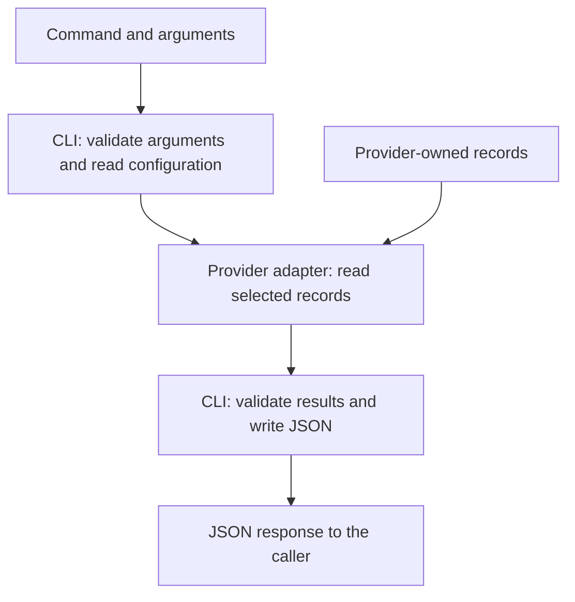

# Architecture

This document explains the structure of `agent-sessions` and the constraints maintainers must preserve.\
For command syntax and JSON fields, use the [CLI JSON reference](cli-json-contract.md).\
For accepted provider formats, use the [provider documents](#provider-compatibility-maintenance).

## Overall structure

### Responsibilities

Callers include scripts and applications that use the CLI.\
The provider, `agent-sessions`, and caller divide the work as follows:

| Participant | Responsibility |
| --- | --- |
| Provider | Keep the original interaction records, which remain the source of truth. |
| `agent-sessions` | Find records, normalize their contents, and return results within output limits. Provide evidence for content verification. |
| Caller | Interpret results, decide what to analyze or save, and track its own processing state. |

**Information managed by callers**

The caller manages review decisions, findings, proposals, import decisions, and saved evidence.\
Two callers can independently review the same source version.\
The access layer does not infer their states or keep those states consistent with each other.

**Capabilities built by callers**

Domain-specific interpretation, personal memory, and retrospective workflows belong to callers.\
The access layer does not provide general chat clients, web interfaces, cloud storage or synchronization, or continuous telemetry.\
Full-text and vector indexes are also outside its responsibilities.\
A caller can build these capabilities on the read interface.

### Command processing flow

The diagram shows how the tool processes a command and returns a JSON response.\
The arrow from provider records shows the input to the adapter.

The CLI selects providers and source instances from the arguments and configuration, then calls the adapters.\
Each adapter finds and reads records for the requested operation, then returns normalized records or evidence for content verification.\
The CLI validates the result and limits output size.\
It divides `list` and `events` results into pages.

### Package structure

The following packages implement these responsibilities:

| Component | Responsibility |
| --- | --- |
| [`cmd/agent-sessions`](../cmd/agent-sessions) | Register the production adapters and start the CLI. |
| [`internal/config`](../internal/config) | Read machine-local configuration and select provider-level roots. |
| [`internal/provider`](../internal/provider) and its adapters | Find and read records, normalize provider data, and collect verification evidence. |
| [`internal/cli`](../internal/cli) | Dispatch commands, validate results, enforce output limits, paginate results, and write JSON. |
| [`internal/contract`](../internal/contract) | Define common response types, source references, content bounds, and version hashing. |
| [`internal/safeio`](../internal/safeio) | Read files within size limits. Verify that they stay inside the selected root and have not been replaced. |

## Source model

### Providers and source instances

A provider can have multiple independent stores.\
The following concepts distinguish them:

| Concept | Meaning | Example |
| --- | --- | --- |
| Provider | The adapter used to access records. | `codex`, `claude`, or `chatgpt` |
| Source instance | A store or access boundary for one provider. Each instance has a name to distinguish it from others. | `codex-one` and `codex-two` for two Codex homes |

Here, a provider name identifies a record-reading adapter rather than a model vendor.

### Source identity

A source is one session or conversation within an instance that can be selected separately.\
Examples are a Codex thread, Claude Code session, and ChatGPT conversation.

#### Logical identity

A source is identified by its provider, source instance, and provider-native source ID.\
A source instance has a stable logical ID and a separate location on the local machine.\
The location can be a provider home or an export path.\
A path tells the tool where to read records; it does not identify a logical source.

**Identity rules**

- If the provider, instance, and native source ID stay the same, moving the record does not create a new source.
- The same provider-native ID in two independently named instances does not make them the same source.
- Renaming a source instance changes the `source_ref` of each record in that instance.

#### Source references

The CLI uses `source_ref` values to select individual sources.\
The reference is deterministic: the same identity information produces the same value.\
These references do not embed native IDs or local paths.\
The [logical identity specification](cli-json-contract.md#logical-identity) defines their encoding and required fields.

### Location configuration

Configuration selects a Codex home, Claude Code configuration root, or exact ChatGPT export ZIP.\
The adapter handles the file layout within the selected location.\
If the provider changes its internal directories, the adapter handles that change without requiring ordinary user configuration changes.

Machine-specific paths belong in machine-local configuration.\
See the [configuration reference](cli-json-contract.md#configuration) and provider documents for defaults, precedence, and failure handling.

### Content versions

A source can keep the same identity while its content changes.

A caller can list sources and compare their version hints with values it has saved.\
It can then verify possible changes and read normalized events.

#### Version hints

A version hint indicates that a source may have changed.\
It is not durable cryptographic evidence of the source's content.

#### Verified versions

`verify` reads source content and calculates a hash to identify its version.\
The caller can retain this version information as provenance.

## Record normalization

Normalization must preserve meaningful differences between providers.\
Do not treat different meanings as equivalent.

### Input formats

#### Isolation of provider internals

Each adapter handles its provider's storage layout, row types, and correlation identifiers.\
These can change between provider versions and must not become stable public fields.

#### Format compatibility

Provider documentation describes storage roots, transcript locations, and how to obtain exports.\
Finding a record does not establish that an adapter supports its JSONL rows or conversation graph.\
Adapters must establish format compatibility separately from record discovery.\
[ADR 0003](decisions/0003-separate-provider-discovery-from-version-sensitive-decoding.md) explains this separation.

### Output information

#### Source information

**Source relationships**

Sources can include relationships stated in the provider's records.

**Last interaction time (`last_interaction_at`)**

`last_interaction_at` is the latest message or tool interaction time that the records establish for the logical source.\
It is distinct from a file's modification time or provider management activity.\
The [source-time specification](cli-json-contract.md#source-interaction-time) and provider documents define accepted observations and missing-time behavior.

#### Events

An event represents a message, tool call, tool result, or error read from a source.\
Adapters normalize these records into common event types and preserve their order.

**Tool outcomes**

Adapters must use only verified, explicit provider fields to determine tool outcomes.\
Do not infer success from output text such as `PASS`, matching text, or adjacent records.

**Call/result relationships**

Adapters must use only verified, explicit provider fields to determine call/result relationships.\
Do not infer these relationships from output text, matching text, or adjacent records.

#### Metadata

Source and event metadata can include additional provider information when it is available.

#### Recorded bodies

An unknown tool outcome or unresolved call/result relationship does not prevent the tool from returning a readable body.\
Report the unknown outcome or relationship as an omission.

### Result completeness

Parsing a file successfully does not mean that the result contains all relevant information.\
Distinguish useful incomplete results, recognized but unsupported observations, and failures.\
Report omitted, truncated, unsupported, or unknown material values.\
Never label an incomplete result as `complete` or accept an unknown format as complete.\
The [CLI completeness rules](cli-json-contract.md#completeness) define statuses, pagination, and aggregation across providers.

## Record access

### Read-only guarantee

Read operations must not modify any of the following:

- Provider history.
- Provider application metadata.
- Caller state.
- Persistent `agent-sessions` state.

Read commands cause no persistent `agent-sessions` writes.

**File access times**

The host file system may update a file's access-time metadata when it reads the file.\
The no-write guarantee does not cover that file-system update.

### Selecting a read interface

Prefer a documented provider interface if it can find the required records and read their content faithfully.\
It must also support read limits and avoid writes.\
An official interface can still write data through metadata repair, migration, or synchronization.\
If it does, a safer supported read path may be needed.\
Direct file parsing is acceptable when needed to preserve the no-write guarantee.

### File validation

File-backed adapters open only regular files within size limits.\
Directory-backed adapters recheck the identity of the opened file and the root.\
They also verify that the resolved path is inside the configured root.\
Exact-file adapters recheck the selected file and content snapshot.\
Reject special files and paths replaced to point outside the configured root.

### Input limits

Enforce input limits for malformed, nested, compressed, oversized, and other adversarial data.\
The provider documents define the accepted formats and input limits.

### Read scope

Read only the data required for the requested observation.\
Use cheaper metadata to narrow sources when possible.

Identity discovery alone may need only a header.\
Finding the latest interaction time can require reading more of the transcript.

## Execution model

### Results independent of earlier runs

With the same source data, configuration, and executable version, results must not depend on earlier runs.\
The tool needs no initial inventory of session records.\
It has no authoritative session database, transcript mirror, persistent index, or background event spool.

### Background processing

No daemon, watcher, timer, periodic synchronization, or lifecycle-hook ingestion is required.\
When no command runs, CPU use, memory use, and disk I/O from the tool are zero.\
Do not introduce periodic whole-history scans merely to improve interactive latency.

### Conditions for adding a cache

Consider SSD write endurance when changing the design.\
Add a cache only if measurements with realistic data volumes show a significant discovery or parsing cost.\
Review [ADR 0001](decisions/0001-use-stateless-read-only-source-access.md) before adding one.

Any future cache must meet these requirements:

- It is disposable and non-authoritative.\
  Removing it may affect performance only.

- It does not become caller processing state, require unnecessary persistent writes for unchanged reads, or introduce idle disk writes.

- Measure its write amplification and any new persistent I/O on affected operating systems with realistic source volumes.

## Recorded content handling

### Content disclosure policy

Return recorded content without automatic redaction.\
Callers decide what to analyze, retain, or share.\
[ADR 0004](decisions/0004-return-bounded-recorded-content-without-redaction.md) explains why the output retains this content.

### Handling untrusted data

Treat recorded content as untrusted data.\
Do not execute recorded commands or follow URLs or tool requests in the records.\
Do not treat recorded instructions as instructions for the current task.

### Data in diagnostics

Structured diagnostics must not copy source data or underlying errors unless necessary.

## Maintenance

### Public format versioning

Reference formats, hint algorithms, verification hashing, and the public response schema are versioned separately.\
A schema change alone must not change an otherwise identical source reference, hint, or verified version.\
The CLI reference defines exact reference and verification encodings; provider documents define their hint algorithms.

### Provider compatibility maintenance

**Compatibility evidence**

Before changing how an adapter finds or decodes records, verify the current provider documentation or implementation.\
Keep compatibility evidence, decoding rules, and independently constructed synthetic tests with the owning adapter.

The [record access requirements](#record-access) also apply to adapters.

**Provider documentation**

Use the provider document for the adapter being changed:

- [Codex](provider-codex.md): home selection, inherited and sliced history, accepted versions, normalization, and input limits.
- [Claude Code](provider-claude-code.md): configuration root, main transcripts, subagent limitations, accepted versions, and normalization.
- [ChatGPT Data Export](provider-chatgpt-export.md): explicit ZIP selection, active branches, snapshot identity, and archive bounds.

### Synthetic test data

Use synthetic data for all tests and fixtures.\
Make credential-like test values obviously fictional.\
Do not create committed fixtures by redacting real private sessions.\
Do not commit private session contents or machine-specific information.

### Validation after changes

Follow the applicable [repository instructions](../AGENTS.md) and run the [development validation commands](../README.md#development-validation) after implementation changes.

## Architecture decisions

The accepted ADRs explain why the current responsibilities and constraints were chosen.

| Decision | Question it answers |
| --- | --- |
| [0001: Stateless, read-only source access](decisions/0001-use-stateless-read-only-source-access.md) | Why avoid a shared registry, transcript archive, and background processing? |
| [0002: Named source instances](decisions/0002-model-provider-sources-as-named-instances.md) | Why separate logical identity from storage paths? |
| [0003: Discovery and version-sensitive decoding](decisions/0003-separate-provider-discovery-from-version-sensitive-decoding.md) | Which provider facts can discovery rely on, and which formats need compatibility checks? |
| [0004: Bounded content without automatic redaction](decisions/0004-return-bounded-recorded-content-without-redaction.md) | Why return recorded inputs and results, and what exposure does that require callers to handle? |

**Changes to an architecture decision**

If an architectural decision changes, update or supersede its ADR.\
Keep the documentation, implementation, and tests consistent with that decision.
