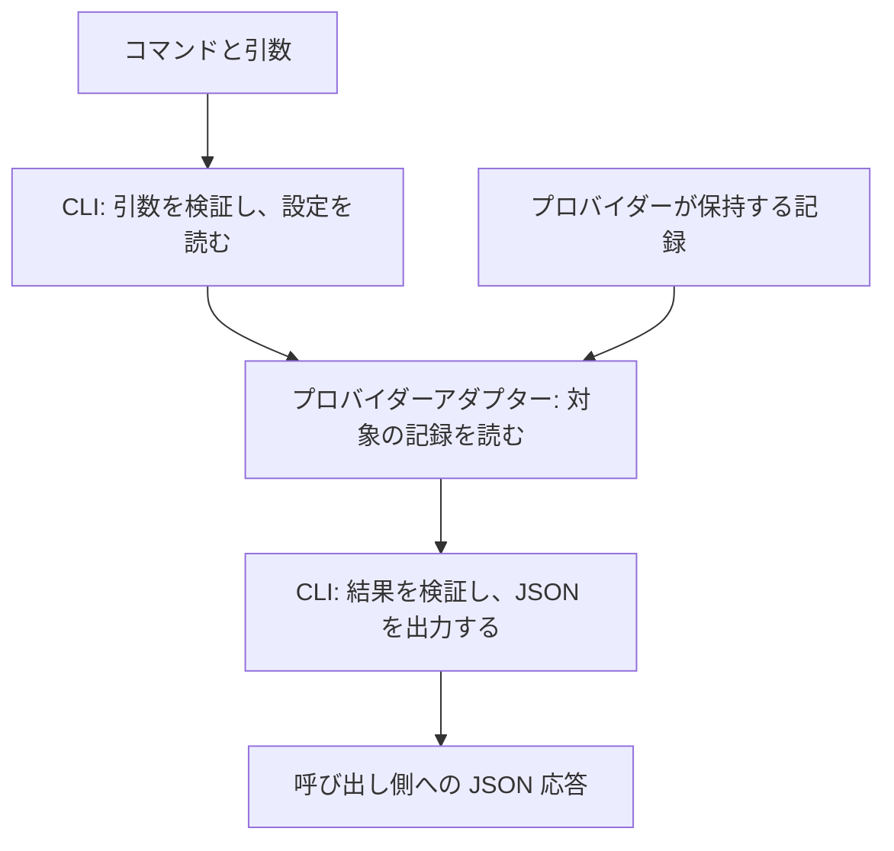

# アーキテクチャ

> **注記:** [英語版](../architecture.md) が正式版である。
> この日本語版は参考訳である。
> 内容に差異がある場合は英語版を優先する。

この文書は、保守者向けに `agent-sessions` の構成と、変更時に守る制約を説明する。\
コマンド構文と JSON フィールドは [CLI JSON 仕様](cli-json-contract.md)、対応するプロバイダーの形式は [プロバイダー別の文書](#プロバイダー互換性の保守) を参照する。

## 全体構成

### 責任分担

呼び出し側とは、CLI を使うスクリプトやアプリケーションを指す。\
プロバイダー、`agent-sessions`、呼び出し側は、次のように作業を分担する。

| 担当 | 責任 |
| --- | --- |
| プロバイダー | 対話記録の元データを保持する。これが正式なデータ源となる。 |
| `agent-sessions` | 記録を見つけ、内容を正規化し、出力上限を守って結果を返す。内容の検証に使う証拠も提供する。 |
| 呼び出し側 | 結果を解釈し、分析や保存の対象を選び、自分の処理状態を管理する。 |

**呼び出し側が管理する情報**

レビューの判断、所見、提案、取り込みの判断、保存する証拠は、呼び出し側が管理する。\
二つの呼び出し側は、同じソースの版を独立してレビューできる。\
アクセス層は、両者の状態を推定したり、互いに一致させたりしない。

**呼び出し側で構築する機能**

領域固有の解釈、個人メモリ、振り返りの手順は、呼び出し側が扱う。\
アクセス層は、汎用チャットクライアント、Web UI、クラウド保存と同期、継続的なテレメトリを提供しない。\
全文索引とベクトル索引も、アクセス層の責任に含めない。\
呼び出し側は、読み取りインターフェースを使ってこれらの機能を構築できる。

### コマンド処理の流れ

次の図は、コマンドを処理して JSON 応答を返すまでの流れを示す。\
プロバイダーの記録からの矢印は、アダプターへの入力を示す。

CLI は、引数と設定からプロバイダーとソースインスタンスを選び、アダプターを呼び出す。\
各アダプターは、要求された操作に必要な記録を見つけて読み、正規化した記録、または内容の検証に使う証拠を返す。\
CLI は結果を検証し、出力サイズを制限する。\
`list` と `events` の結果はページに分割する。

### パッケージ構成

これらの責任を、次のパッケージで実装する。

| 構成要素 | 担当すること |
| --- | --- |
| [`cmd/agent-sessions`](../../cmd/agent-sessions) | 本番用アダプターを登録し、CLI を起動する。 |
| [`internal/config`](../../internal/config) | マシン固有の設定を読み、プロバイダー単位のルートを選ぶ。 |
| [`internal/provider`](../../internal/provider) と各アダプター | 記録を見つけて読み、プロバイダーのデータを正規化し、検証に使う証拠を集める。 |
| [`internal/repository`](../../internal/repository) | 正規化した作業場所の根拠を、書き込みをせずローカル Git 管理情報と照合する。 |
| [`internal/cli`](../../internal/cli) | コマンドを振り分け、結果を検証し、出力上限を守って結果をページに分割し、JSON を出力する。 |
| [`internal/contract`](../../internal/contract) | 共通の応答型、ソース参照、内容の上限、バージョンのハッシュ化を定義する。 |
| [`internal/safeio`](../../internal/safeio) | サイズ上限内のファイルを読む。選択したルートの範囲内にあり、差し替えられていないことを確かめる。 |

## ソースモデル

### プロバイダーとソースインスタンス

一つのプロバイダーに、独立した複数の保存場所がある場合がある。\
これらを次の概念で区別する。

| 概念 | 意味 | 例 |
| --- | --- | --- |
| プロバイダー | 記録へのアクセスに使うアダプター。 | `codex`、`claude`、`chatgpt` |
| ソースインスタンス | 一つのプロバイダーに属する保存場所やアクセス範囲。他のインスタンスと区別するために名前を付ける。 | 二つの Codex ホームに付ける `codex-one` と `codex-two` |

ここでのプロバイダー名は、記録を読むアダプターを識別するもので、モデルの提供元を表すものではない。

### ソースの識別

ソースは、インスタンス内で個別に指定できる、プロバイダーが保持する一つの対話記録である。\
Codex のスレッド、Claude Code のセッション、ChatGPT の会話が該当する。

#### 論理識別子

ソースは、プロバイダー、ソースインスタンス、プロバイダー固有のソース ID で識別する。\
ソースインスタンスには、安定した論理 ID と、ローカルマシン上の保存場所がある。\
保存場所は、プロバイダーホームやエクスポートのパスで指定する。\
パスは記録を読む場所を示すもので、論理ソースの識別子にはしない。

**識別の規則**

- プロバイダー、インスタンス、プロバイダー固有のソース ID が同じなら、記録を移動しても新しいソースにはならない。
- 独立して名付けた二つのインスタンスに同じプロバイダー固有 ID があっても、同じソースにはならない。
- ソースインスタンスの名前を変えると、その中の各記録の `source_ref` も変わる。

#### ソース参照

CLI は、個別のソースを指定するために `source_ref` を使う。\
同じ識別情報からは、常に同じ値が得られる。\
この参照は、プロバイダー固有の ID やローカルパスを含まない。\
符号化と必須フィールドは [論理識別子の仕様](cli-json-contract.md#論理識別子) で定義する。

### 保存場所の指定

設定では、Codex ホーム、Claude Code の設定ルート、または一つの ChatGPT エクスポート ZIP を指定する。\
指定した場所の内部のファイル配置は、アダプターが扱う。\
プロバイダーが内部のディレクトリ構成を変えた場合も、アダプターで対応し、通常の利用者設定を変える必要がないようにする。

マシン固有のパスは、マシン固有の設定に置く。\
既定値、優先順位、失敗時の扱いは [設定の仕様](cli-json-contract.md#読み取り対象の設定) と各プロバイダー文書を参照する。

### 内容のバージョン

ソースは、識別子を保ったまま内容が変わることがある。

呼び出し側は、ソースの一覧を取得し、バージョンヒントを保存済みの値と比較できる。\
その後、変更の可能性があるものを検証し、正規化したイベントを読める。

#### バージョンヒント

バージョンヒントは、ソースが変わった可能性を示す。\
ソースの内容を証明する、永続的な暗号学的証拠ではない。

#### 検証済みバージョン

`verify` はソースの内容を読み、内容のバージョンを識別するハッシュ値を計算する。\
呼び出し側は、このバージョン情報を出所の証拠として保存できる。

## 記録の正規化

正規化では、プロバイダー間の意味のある違いを保つ。\
意味が異なるものを同じものとして扱ってはならない。

### 入力形式

#### プロバイダー内部形式の隔離

各アダプターは、プロバイダー固有のファイル配置、行の種類、相関識別子を扱う。\
これらはプロバイダーの版によって変わるため、安定した公開フィールドにしてはならない。

#### 形式の互換性確認

プロバイダー文書は、保存先のルート、トランスクリプトの場所、エクスポートの取得方法を説明する。\
記録を見つけられても、その JSONL 行や会話グラフをアダプターが扱えるとは限らない。\
記録の検出とは別に、形式の互換性を確かめる必要がある。\
この分離の理由は [ADR 0003](../decisions/0003-separate-provider-discovery-from-version-sensitive-decoding.md) を参照する。

### 出力情報

#### ソース情報

**ソース間の関係**

ソースには、プロバイダーの記録に明記された関係を含めることができる。

**最後のやり取りの時刻 (`last_interaction_at`)**

`last_interaction_at` は、論理ソースの記録から確認できた、最後のメッセージまたはツールのやり取りの時刻を表す。\
ファイルの更新時刻やプロバイダーの管理処理とは区別する。\
受け付ける観測と時刻がない場合の扱いは、[ソースのやり取りの時刻](cli-json-contract.md#ソースのやり取りの時刻) と各プロバイダー文書で定義する。

**作業場所とリポジトリ検索**

アダプターは、選択した論理履歴から、記録された作業場所と明示的な worktree の対応関係を取得する。\
プロバイダーのフィールドと版の検査はアダプターが担当し、会話の文章やコマンドから移動を推測しない。\
リポジトリの解決処理は Git 共通管理ディレクトリと登録を読む。\
現在のファイルシステムの根拠、残存する登録、確認したプロバイダーの対応情報を区別し、不確実性や矛盾を保持する。\
CLI はページ分割前にソースを絞り込み、利用側の分析は引き続きこの層の対象外とする。\
完全性と過去の所属を調べる際の限界は、[公開検索仕様](cli-json-contract.md#ローカル-git-リポジトリのセッションを探す) を参照する。

Git の読み取りでは、子プロセスの出力上限とタイムアウトを設け、任意ロックとファイルシステム監視を無効にする。\
継承した Git のリポジトリ・設定上書きを取り除き、この読み取りではシステムとグローバルの Git 設定を無効にする。\
使用するのは `rev-parse` と `worktree list` だけで、修復、prune、refresh、Hook、永続的な対応表や索引は追加しない。\
Git 管理情報は提供元内容の版検証の根拠には含めない。

#### イベント

イベントは、ソースから読んだメッセージ、ツール呼び出し、ツール結果、エラーを表す。\
アダプターは、これらの記録を共通のイベント型に正規化し、順序を保つ。

**ツールの成否**

アダプターは、確認済みの明示的なプロバイダーフィールドだけから、ツールの成否を確定する。\
`PASS` などの出力文字列、文章の一致、隣り合う記録から、成功を推定してはならない。

**呼び出しと結果の対応関係**

アダプターは、確認済みの明示的なプロバイダーフィールドだけから、呼び出しと結果の対応関係を確定する。\
出力文字列、文章の一致、隣り合う記録から、対応関係を推定してはならない。

#### メタデータ

ソースとイベントのメタデータには、追加のプロバイダー情報があれば含めることができる。

#### 記録された本文

ツールの成否や呼び出しと結果の対応関係が不明でも、読める本文は返せる。\
成否や対応関係が不明であることは、省略として報告する。

### 取得結果の完全性

ファイルの解析に成功しても、結果に必要な情報がすべて含まれるとは限らない。\
有用だが不完全な結果、認識できるが未対応の観測、失敗は区別する。\
重要な値の欠落、切り詰め、未対応、不明を報告する。\
不完全な結果や未知の形式を `complete` として扱ってはならない。\
状態、ページ分割、プロバイダーをまたぐ集約は [CLI の完全性の規則](cli-json-contract.md#完全性) で定義する。

## 記録へのアクセス

### 読み取り専用の保証

読み取り操作では、次のいずれも変更してはならない。

- プロバイダーの履歴。
- プロバイダーのアプリケーションのメタデータ。
- 呼び出し側の状態。
- 永続的な `agent-sessions` の状態。

読み取りコマンドは、`agent-sessions` による永続的な書き込みを行わない。

**アクセス時刻の更新**

ホストのファイルシステムが、ファイルの読み取りに伴ってアクセス時刻を更新する場合はある。\
このファイルシステムによる更新は、書き込み禁止の保証に含めない。

### 読み取りインターフェースの選択

必要な記録を見つけ、内容を忠実に読み取れるなら、プロバイダーが文書化したインターフェースを優先する。\
読み取りに上限を設けられ、書き込みが発生しないことも条件となる。\
公式のインターフェースでも、メタデータの修復、データの移行、同期に伴って書き込む場合がある。\
その場合は、対応している別の読み取り方法から、より安全なものを選ぶ必要があるかもしれない。\
書き込み禁止の保証を守るために必要なら、ファイルの直接解析を使える。

### ファイルの検証

ファイルを読むアダプターは、サイズ上限内の通常ファイルだけを開く。\
ディレクトリを対象とするアダプターは、開いたファイルとルートが差し替えられていないことを再確認する。\
パスを解決した結果が、設定したルートの範囲内にあることも確かめる。\
ファイルを直接指定するアダプターは、選択したファイルと内容のスナップショットを再確認する。\
特殊ファイルや、設定したルートの範囲外を指すように差し替えられたパスは拒否する。

### 入力の上限

不正な形式、深い入れ子、圧縮、サイズ超過、その他の敵対的な入力に上限を設ける。\
受け付ける形式と入力上限は、各プロバイダー文書で定義する。

### 読み取る範囲

要求された観測に必要な範囲だけを読む。\
低コストのメタデータでソースを絞れる場合は、それを使う。

識別子の検出だけなら、ヘッダーを読めばよい場合もある。\
最後のやり取りの時刻を確かめるには、トランスクリプトをさらに読む必要がある場合もある。

## 実行方式

### 過去の実行に依存しない結果

ソースデータ、設定、実行ファイルの版が同じなら、結果は過去の実行に依存してはならない。\
セッション記録の事前登録は必要ない。\
正式なセッションデータベース、対話記録のミラー、永続的な索引、バックグラウンドのイベント保管領域は設けない。

### バックグラウンド処理

デーモン、監視処理、タイマー、定期的な同期、ライフサイクルフックによる取り込みは必要ない。\
コマンドが動いていないとき、ツールによる CPU 使用、メモリ使用、ディスク I/O はゼロである。\
対話時の遅延を下げるだけのために、定期的な全履歴走査を導入してはならない。

### キャッシュを導入する条件

設計を変えるときは、SSD の書き込み耐久性を考慮する。\
実際の利用に近いデータ量で測定し、記録の検出や解析に大きな負荷があると分かった場合だけ、キャッシュを追加できる。\
導入前に [ADR 0001](../decisions/0001-use-stateless-read-only-source-access.md) を確認する。

将来追加するキャッシュは、次の要件を満たす必要がある。

- 破棄可能で、正式なデータ源にしない。\
  削除して変わるのは性能だけとする。

- 呼び出し側の処理状態にせず、変化のない読み取りに不要な永続書き込みを要求せず、待機中にディスクへ書き込まない。

- 書き込み増幅と新たな永続 I/O を、影響を受ける OS と現実的なソース量で測定する。

## 記録内容の取り扱い

### 本文の公開方針

記録された内容は自動で伏せずに返す。\
分析、保存、共有の対象は呼び出し側が決める。\
この内容を出力に保持する理由は [ADR 0004](../decisions/0004-return-bounded-recorded-content-without-redaction.md) を参照する。

### 信頼できないデータの扱い

記録の内容は、信頼できないデータとして扱う。\
記録されたコマンドを実行したり、記録内の URL やツール要求に従ったりしてはならない。\
記録内の指示を、現在の作業への指示として扱ってはならない。

### 診断への転記

構造化した診断に、元データや下位のエラーを不必要にコピーしてはならない。

## 保守

### 公開形式のバージョン管理

設定と CLI 応答には、それぞれ [CLI JSON 仕様](cli-json-contract.md) に定める一つの現行形式がある。

参照形式、ヒントのアルゴリズム、検証用のハッシュ化は、それぞれ独立した版を持つ。\
応答形式だけを変えたときに、ほかに変更のないソース参照、ヒント、検証済みバージョンを変えてはならない。\
参照と検証の正確な符号化は CLI 仕様、ヒントのアルゴリズムは各プロバイダー文書で定義する。

### プロバイダー互換性の保守

**互換性の根拠**

アダプターによる記録の検出方法やデコード方法を変える前に、現在のプロバイダー文書または実装を確かめる。\
互換性の証拠、デコード規則、独立して作った合成テストは、対応するアダプターとともに保守する。

アダプターは、共通の [記録へのアクセスの要件](#記録へのアクセス) も守る。

**プロバイダー別の文書**

変更するアダプターに応じて、次の文書を参照する。

- [Codex](provider-codex.md): ホームの指定、継承と切り出し、対応版、正規化、入力上限。
- [Claude Code](provider-claude-code.md): 設定ルート、主トランスクリプト、サブエージェントの制限、対応版、正規化。
- [ChatGPT Data Export](provider-chatgpt-export.md): 明示的な ZIP 指定、アクティブな分岐、スナップショットの識別、アーカイブ上限。

### テスト用の合成データ

テストとフィクスチャには、合成データだけを使う。\
認証情報に似たテスト値は、明らかに架空と分かるものにする。\
実際の非公開セッションを伏せ字にして、コミットするフィクスチャに変換してはならない。\
非公開のセッション内容やマシン固有の情報をコミットしてはならない。

### 変更後の検証

変更内容に応じて [リポジトリの指示](../../AGENTS.md) に従い、実装を変えた後は [開発時の検証コマンド](../../README.ja.md#開発時の検証) を実行する。

## 設計判断

採用済みの ADR は、現在の責任分担と制約を選んだ理由を説明する。

| 判断 | 答える疑問 |
| --- | --- |
| [0001: ステートレスな読み取り専用アクセス](../decisions/0001-use-stateless-read-only-source-access.md) | なぜ共有の登録簿、対話記録のアーカイブ、バックグラウンド処理を設けないか。 |
| [0002: 名前付きソースインスタンス](../decisions/0002-model-provider-sources-as-named-instances.md) | なぜ論理的な識別と保存場所のパスを分けるか。 |
| [0003: 検出とバージョン依存のデコード](../decisions/0003-separate-provider-discovery-from-version-sensitive-decoding.md) | 検出が依存できるプロバイダーの情報と、互換性確認が必要な形式は何か。 |
| [0004: 自動で伏せずに返す上限付きの記録内容](../decisions/0004-return-bounded-recorded-content-without-redaction.md) | なぜ記録された入力と結果を返し、その公開範囲を呼び出し側が扱う必要があるか。 |

**設計判断を変えるとき**

設計判断を変える場合は、該当する ADR を更新または置き換える。\
文書、実装、テストも、その判断と一致させる。
